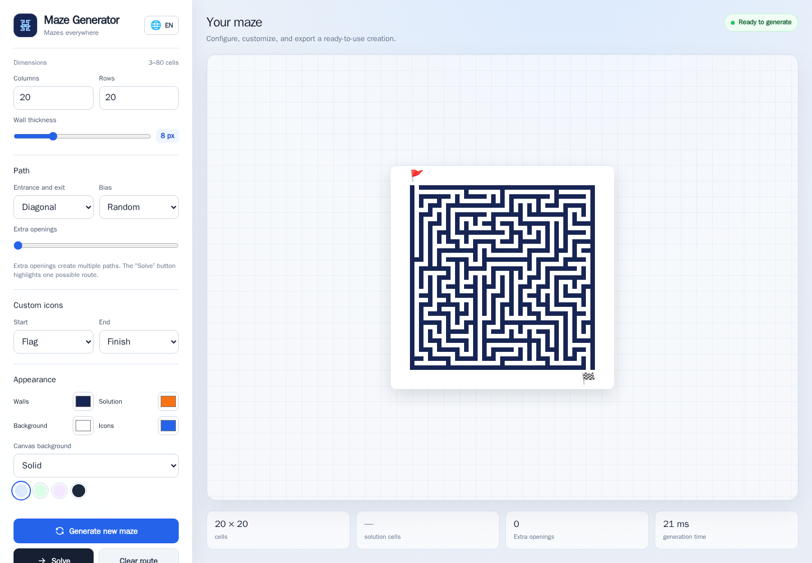
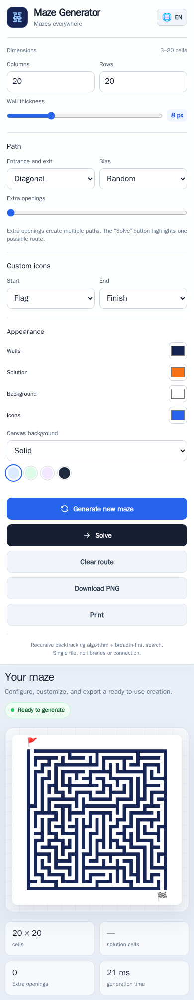
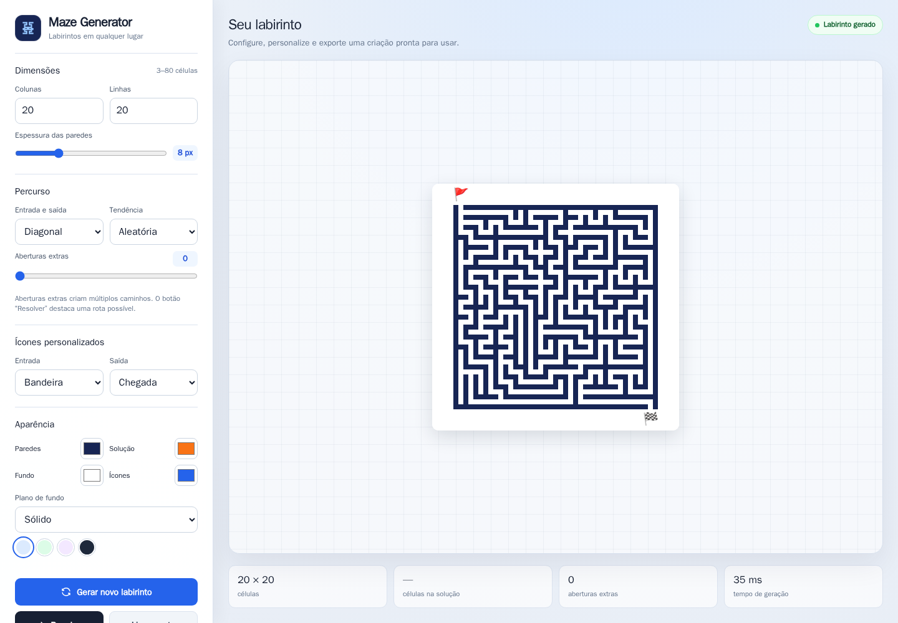
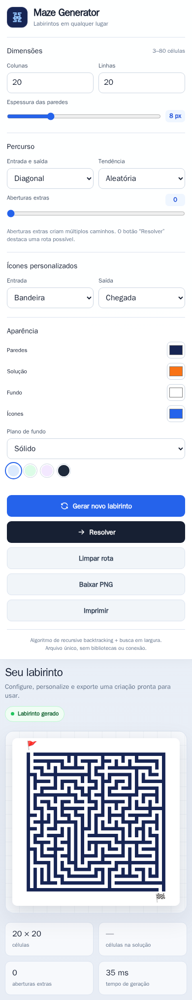

# Maze Generator

Create mazes using the [recursive backtracking algorithm](https://en.wikipedia.org/wiki/Maze_generation_algorithm#Recursive_backtracker).

Check out the [maze generator demo](https://keesiemeijer.github.io/maze-generator/).

## Standalone redesigned interface

This repository also includes a self-contained standalone version in
[`maze-generator-standalone.html`](./maze-generator-standalone.html). It provides
a modern interface that works locally and offline in the browser, with no
external dependencies.

### Features

- Responsive interface for desktop and mobile.
- Visual controls for dimensions, wall thickness, entrances/exits, bias, and
  extra openings.
- Appearance customization with color pickers and quick themes: Ocean, Forest,
  Plum, and Night.
- Canvas background options: solid, gradient, grid, dots, and paper.
- Custom icons for the entrance and exit.
- Path solving with highlighted route and an option to clear the solution.
- PNG export and print support.
- Status and statistics indicators for size, extra openings, solution cells,
  and generation time.
- Preferences persisted with `localStorage`.
- Single-file implementation with HTML, CSS, and JavaScript.

### Screenshots

#### Desktop

#### Mobile

**Note:** Maze dimensions are restricted to values between 3 and 80 cells.
These limits can be changed in the standalone file if needed. Larger mazes
consume more memory because the complete maze is kept in memory while using
recursive backtracking.

## GitHub Pages

To publish the standalone version with GitHub Pages:

1. Open **Settings → Pages** in the `Raphango/maze-generator-plus` repository.
2. Under **Build and deployment**, select **Deploy from a branch**.
3. Choose a branch (for example, `main`) and the **`/ (root)`** folder.
4. Open:
   - `https://raphango.github.io/maze-generator-plus/`
   - `https://raphango.github.io/maze-generator-plus/maze-generator-standalone.html`

The `index.html` file redirects to `maze-generator-standalone.html`.

## License

MIT

---

# Gerador de Labirintos

Crie labirintos usando o
[algoritmo de retrocesso recursivo](https://en.wikipedia.org/wiki/Maze_generation_algorithm#Recursive_backtracker).

Confira a [demonstração do gerador de labirintos](https://keesiemeijer.github.io/maze-generator/).

## Interface standalone repaginada

Este repositório também inclui uma versão standalone autocontida em
[`maze-generator-standalone.html`](./maze-generator-standalone.html). Ela
oferece uma interface moderna que funciona localmente e offline no navegador,
sem dependências externas.

### Características

- Interface responsiva para desktop e dispositivos móveis.
- Controles visuais para dimensões, espessura das paredes, entradas/saídas,
  tendência e aberturas extras.
- Personalização da aparência com seletores de cores e temas rápidos: Oceano,
  Floresta, Ameixa e Noite.
- Opções de plano de fundo do canvas: sólido, gradiente, grade, pontos e papel.
- Ícones personalizados para a entrada e a saída.
- Resolução do caminho com rota destacada e opção de limpar a solução.
- Exportação em PNG e suporte à impressão.
- Indicadores de status e estatísticas para tamanho, aberturas extras, células
  na solução e tempo de geração.
- Preferências persistidas com `localStorage`.
- Implementação em arquivo único com HTML, CSS e JavaScript.

### Screenshots

#### Desktop

#### Dispositivo móvel

**Observação:** As dimensões do labirinto são limitadas a valores entre 3 e 80
células. Esses limites podem ser alterados no arquivo standalone, se necessário.
Labirintos maiores consomem mais memória porque o labirinto completo é mantido
na memória durante o uso do retrocesso recursivo.

## GitHub Pages

Para publicar a versão standalone com o GitHub Pages:

1. Abra **Settings → Pages** no repositório `Raphango/maze-generator-plus`.
2. Em **Build and deployment**, selecione **Deploy from a branch**.
3. Escolha uma branch (por exemplo, `main`) e a pasta **`/ (root)`**.
4. Acesse:
   - `https://raphango.github.io/maze-generator-plus/`
   - `https://raphango.github.io/maze-generator-plus/maze-generator-standalone.html`

O arquivo `index.html` redireciona para `maze-generator-standalone.html`.

## Licença

MIT
